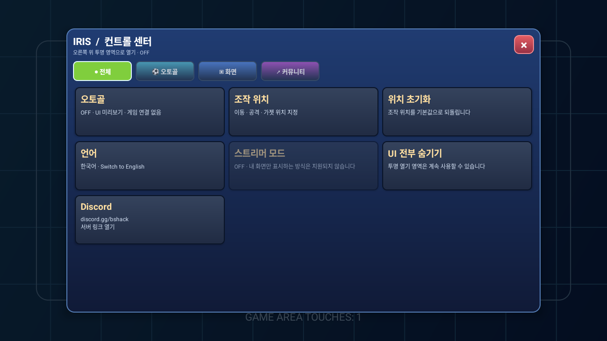

# Iris 오토골 — 브롤스타즈 70.757 내부 실행 후보

**새 panel3 게임 APK:** 이전 `packaging2-test.apk`의 Iris 모듈을 새 UI와 실제 인식·이동·슈팅 코드로 교체했습니다. [받을 파일과 설치 제한](https://github.com/jungeunchan0806/irisai-updates/releases/tag/android-ingame-70.757-panel3). 파일명은 `IrisAutoGoal-BrawlStars-70.757-panel3-test-newkey.apk`입니다. **새 서명이므로 기존 수정본·진단 앱·공식 앱 위에 덮어쓸 수 없습니다.** 기존 게임을 삭제하기 전에 진행 상태 보존 여부를 확인해야 합니다.

panel3는 호스트 테스트 49개와 Android 녹화 프레임 실행 검사 9개를 통과했습니다. 후자는 실제 PixelCopy·OpenCV·ONNX·컨트롤러를 사용하지만 입력 수신 메서드는 테스트용입니다. 원본 게임의 JNI 성공·실제 경기·사용자 폰의 튕김 해결을 확인한 결과가 아닙니다. 느린 분석 뒤 입력이 중간 취소되던 경로를 수정했고 OFF·백그라운드·오래된 결과의 입력은 계속 차단합니다. [모듈 실행 결과](investigation/panel3-engine-pipeline.json), [서명·게임 파일 보존 검증](investigation/panel3-validation.json). 이번 API 35 에뮬레이터에는 설치됐으나 원본 게임의 `Thread-2 nv.Q`로 종료됐습니다. [실제 게임 시작 검사 결과](investigation/panel3-game-launch.json).

**UI 작업 (`android-control-panel`):** 큰 설정창, 오토골 버튼의 가로·세로 2배인 투명 열기 영역, 전체 UI 숨김/복원, 한국어·영어, Discord 링크를 공유 모듈 `controlui`에 구현했습니다. 라이선스 항목은 사용자 요청으로 제외했습니다. `uipreview`는 별도 앱으로 UI만 검증하며 게임 실행이나 조작은 하지 않습니다. [현재 범위와 제한](ui-distribution/RELEASE-KO.md). 기존 게임의 종료 문제는 여전히 미해결이며 같은 서명의 업데이트용 키가 현재 작업환경에 없습니다.

[UI 미리보기 APK 받기](https://github.com/jungeunchan0806/irisai-updates/releases/tag/android-control-panel-preview1) · [검증 결과](investigation/control-panel-validation.json) · [작은 화면](docs/control-panel/compact-panel-ko.png) · [전체 UI 숨김 상태](docs/control-panel/wide-hidden.png)

API 35 에뮬레이터의 두 화면 크기에서 UI 검사 각각 10개, 단위 테스트 12개와 Lint를 통과했습니다. 사용자의 Android 17 실기기 및 게임 실행은 이 검증에 포함되지 않습니다.



**재시도 시험본:** `IrisAutoGoal-BrawlStars-70.757-packaging2-test.apk`는 기존 패키징이 삭제한 메타데이터 128개를 보존합니다. 서비스 등록 파일 2개가 포함됩니다. 이 누락은 확인해 수정했으나 **실기기 `nv.s: 01` 종료 해결은 아직 미확인**입니다. [변경·설치 안내](distribution/packaging2/RELEASE-SECTION-KO.md), [정적 검증 결과](investigation/packaging2-validation.json).

**실기기 시작 실패가 보고됐으며 수정 완료본은 없습니다.** Android 17/API 37 ARM64에서 원본 게임 라이브러리 초기화 중 `nv.s: 01`로 종료됩니다. 같은 폰의 공식 앱은 정상 실행됐다는 사용자 보고가 있습니다. 기존 후보를 재설치해도 해결되지 않습니다. [분석과 확인 한계](investigation/phone-startup-failure.md)

사용자가 제공한 **브롤스타즈 70.757 Android 백업**에 Iris 0.0.9의 공 인식·운반·슈팅 로직을 추가한 수정 APK입니다. **실제 게임 실행과 친선전투가 검증된 최종본은 아닙니다.** 빌드·서명·원본 유지 검사와 오프라인 테스트를 통과한 후보입니다.

## 실행 구조

- 게임 프로세스 안에서 `InitProvider`가 시작되고 게임 화면 위에 **오토골 OFF/ON** 버튼을 표시합니다. 초기값은 OFF입니다.
- 게임 자신의 `SurfaceView`를 PixelCopy로 읽고 기기 안에서 OpenCV·ONNX 모델로 분석합니다. 화면 공유, 접근성, ADB 터치, 다른 앱 위에 표시 권한을 사용하지 않습니다.
- 70.757의 `com.supercell.titan.GameApp.nOnTouchEvent(type, x, y, pointerId)`를 직접 호출합니다. 게임의 기존 JNI 입력 경로이며 게임 상태 메모리를 읽거나 네이티브 함수 주소를 추측하지 않습니다.
- 공 획득 → 골대로 운반 → 골대가 보이고 벽에 가리지 않은 슛을 시도합니다. 브롤볼 HUD가 없거나 결과·하이라이트 화면이면 입력하지 않습니다.
- OFF, 화면 전환, 수동 터치 시 입력을 취소합니다. 오래된 분석 결과는 버리며 입력은 최대 180ms 단위입니다.

## APK 사용 조건

Android 12L/API 32 이상, ARM64 기기가 대상입니다. 다른 버전의 APK에는 이 패치를 적용하지 않습니다. 버전명과 패키지는 원본 `70.757` / `com.supercell.brawlstars`를 유지합니다.

수정본은 별도 키로 서명했으므로 공식 브롤스타즈 설치본 위에 덮어쓰거나 함께 설치할 수 없습니다. 이 프로젝트의 도구는 기존 게임을 삭제하거나 데이터를 지우지 않습니다. 게임의 무결성 검사·서버 버전 정책 때문에 실행이나 접속이 거부될 가능성은 실제 기기 검증 전까지 남아 있습니다.

게임이 실행되면 브롤볼 화면에서 버튼을 한 번 눌러 켜고 다시 눌러 끕니다. 버튼을 길게 누르면 이동·공격·가젯 위치를 지정할 수 있습니다. 위치 지정 중 안내 문구를 누르면 취소됩니다. 직접 게임 화면을 누르면 자동 입력이 꺼집니다.

## 검증 범위

- Java 코어 테스트 32개: 공·골대·메뉴/경기 종료 인식, 경로·슛 판단, 실제 제공 모델의 녹화 화면 추론 포함.
- 내부 입력 시퀀스 테스트 7개: OFF 취소, 지연 콜백 차단, 입력 오류 시 취소, 중복 명령 거절.
- release 빌드 및 Android Lint: 오류 0개. 페이로드의 앱 아이콘·백업 설정, 한국어 문자열, ARM64 한정 배포 관련 경고 4개.
- 원본 분할 APK 6개 서명과 SHA-256 확인. 수정 APK의 v2/v3 서명·정렬·DEX 중복 없음·초기화 진입점·모듈 자산 확인.
- 원본 DEX·네이티브 라이브러리·자산 파일 37,230개 바이트 유지 확인. 원본 C++ 런타임을 유지하고 OpenCV의 필요한 C++ 심볼 223개 존재 확인.
- **실행 검사 실패, 친선전투 0회.** KVM 가속 Android 35의 Google APIs / Google Play 이미지에서 원본과 수정본 모두 설치 후 같은 `nv.Q` 예외로 종료됐습니다. 이후 실제 ARM64/API 37 폰에서도 사용자가 다른 예외인 `nv.s: 01`로 시작 실패를 보고했습니다. 게임 안의 버튼·실제 오토골 동작은 확인하지 못했습니다. 호스트 CPU·녹화 화면 테스트는 폰의 게임 호환성 시험이 아닙니다.

상세 결과: [검증 기록](investigation/ingame-candidate-validation.json), [원본과 수정본 비교](investigation/ingame-ci-comparison.json), [실제 CI 실행](https://github.com/jungeunchan0806/irisai-updates/actions/runs/43221305252). 과거 Frida 실험은 [이전 연구 기록](investigation/README-previous-research.md)에 보존했습니다.

## 소스 빌드

JDK 17, Python 3.11 이상, Android SDK 35 및 build-tools 35.0.0을 준비합니다.

```sh
./gradlew :ingame:assembleRelease :ingame:testReleaseUnitTest :ingame:lintRelease :app:testDebugUnitTest
```

`ingame/build/outputs/apk/release/ingame-release-unsigned.apk`는 **모듈 페이로드**입니다. 단독 설치용 오토골 앱이 아닙니다. `app`은 코어 테스트용 과거 모듈이고, `probe`는 독립 입력 실험 앱입니다.

[APKEditor 1.4.9](https://github.com/REAndroid/APKEditor/releases/tag/V1.4.9)와 [제공된 원본 ZIP](https://github.com/jungeunchan0806/irisai-updates/releases/tag/brawlstars-70.757-backup)을 받은 뒤 본인 서명 키로 게임과 모듈을 결합합니다.

```sh
python tools/build_ingame.py --backup BrawlStars-70.757-BlueStacks-APK.zip \
  --payload ingame/build/outputs/apk/release/ingame-release-unsigned.apk \
  --apkeditor APKEditor-1.4.9.jar --java-home /path/to/jdk17 --sdk /path/to/android-sdk \
  --keystore /private/iris-ingame.p12 --password-file /private/ingame.password \
  --work /temporary/new-build-directory --out /output/IrisAutoGoal-candidate.apk
```

Windows에서는 `gradlew.bat`과 해당 시스템의 경로를 사용하세요. 키스토어와 비밀번호는 저장소에 포함하지 않습니다. 빌드 스크립트는 원본 ZIP과 도구의 해시를 확인하고 새 결과 파일만 생성합니다.

이미 배포된 정확한 packaging2 APK에서 **기존 Iris DEX만 교체**하려면 `tools/update_ingame.py`를 사용합니다. 이전 APK의 해시·서명을 확인하고 Iris 전용 DEX인지 검사한 뒤 바꿉니다. 게임 본체 DEX·자산·네이티브 라이브러리·메타데이터 보존을 다시 검증합니다.

```sh
python tools/update_ingame.py --previous IrisAutoGoal-BrawlStars-70.757-packaging2-test.apk \
  --payload ingame/build/outputs/apk/release/ingame-release-unsigned.apk \
  --apkeditor APKEditor-1.4.9.jar --java-home /path/to/jdk17 --sdk /path/to/android-sdk \
  --keystore /private/iris-ingame-v2.p12 --password-file /private/ingame.password \
  --work /temporary/new-build-directory --out /output/IrisAutoGoal-panel3.apk
```

`enginecheck`는 CI 전용 테스트 앱이며 게임 APK에 합치지 않습니다. 테스트용 `com.supercell.titan.GameApp`은 직접 작성한 입력 기록용 클래스입니다. 원본 게임 코드가 아니며 실제 게임 실행 검증을 대신하지 않습니다. `distribution/panel3`의 차이 파일은 **이미 서명한 정확한 APK를 복원**하기 위한 것으로 개인키를 포함하지 않습니다.

## 서명된 후보 복원·배포

`distribution/candidate1.vcdiff`는 제공된 원본 ZIP에서 서명된 후보 APK를 복원하는 바이너리 차이 파일입니다. 원본 SHA-256, 패치 SHA-256, 결과 APK SHA-256을 모두 확인합니다. 서명용 개인키를 포함하지 않습니다.

```sh
python tools/restore_candidate.py --backup BrawlStars-70.757-BlueStacks-APK.zip \
  --out IrisAutoGoal-BrawlStars-70.757-candidate1.apk --xdelta /path/to/xdelta3
```

GitHub Actions는 동일한 APK를 복원·서명 검증한 뒤 별도 prerelease에 올립니다. 기존 macOS `v0.0.9` 및 업데이트 피드는 변경하지 않습니다.

## 출처와 라이선스

오토골 코어와 모델·이미지: [사용자 제공 IrisAI 0.0.9 소스](https://github.com/jungeunchan0806/irisai-updates/releases/tag/v0.0.9), [CC BY-NC 4.0](IRIS_LICENSE.txt). 원본 자산 해시는 `app/src/main/assets/source.json`에 있습니다. 게임 원본의 권리는 Supercell에 있으며 이 프로젝트는 공식 Supercell 제품이 아닙니다. 게임 내부 입력 연결·패처 코드는 별도로 작성했으며 재배포 금지 타 프로젝트 코드를 복사하지 않았습니다.
